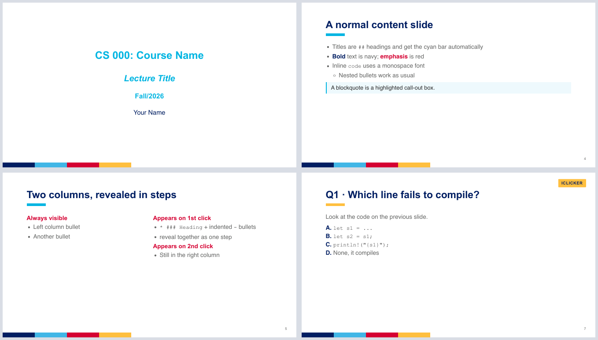

# UIC CS Marp slide template

Write lecture slides in Markdown and get decks that look like the UIC CS
PowerPoint template, with click-to-reveal animations, iClicker quiz slides,
and a PowerPoint-style presenter view. Output is a self-contained HTML deck
(for presenting) and a PDF (for handouts).



## Quick start

Requirements: [Node.js](https://nodejs.org/) (for `npx`) and `python3`.
Marp CLI itself is fetched by `npx` on first run.

1. Click **Use this template** on GitHub, or copy this folder.
2. Copy `slides/example.md` to a new file, e.g. `slides/w01-intro.md`, and edit it.
3. Build:

   ```bash
   ./build.sh
   ```

   This builds every `slides/*.md` into a `.html` and a `.pdf` next to it.
   Build one deck, or skip the PDF while editing:

   ```bash
   ./build.sh --no-pdf slides/w01-intro.md
   ```

4. Open the `.html` in Chrome and press `f` for full screen, or `p` for
   presenter view.

For live preview while writing, install the
[Marp for VS Code](https://marketplace.visualstudio.com/items?itemName=marp-team.marp-vscode)
extension. `.vscode/settings.json` already registers the theme. The VS Code
preview doesn't load the `<pause>` plugin, so it shows those steps fully
revealed.

## Writing slides

Each deck starts with this front matter:

```yaml
---
marp: true
theme: uic-cs
size: 16:9
paginate: true
title: "Lecture Title"
author: Your Name
---
```

Slides are separated by `---`. A slide title is a `##` heading and gets the
cyan underline bar automatically. **Bold** renders navy and *emphasis* renders
red.

### Slide types

Set a slide's type with a comment at the top of that slide:

| Comment | Slide |
|---|---|
| *(none)* | Normal content slide |
| `<!-- _class: title -->` | Centered title slide: `#` course, `##` lecture title, `###` term, then your name |
| `<!-- _class: divider -->` | Section divider: `#` heading plus one line of text |
| `<!-- _class: clicker -->` | iClicker question: gold "ICLICKER" badge |
| `<!-- _class: answer -->` | iClicker answer: navy "ANSWER" badge; `**bold**` in the title shows red |

Add `<!-- _paginate: false -->` to hide the page number on a slide.

### Click-to-reveal

These work in the HTML deck only. The PDF always shows the complete slide.

**`<pause>`:** put it on its own line, starting at the beginning of the line.
Everything after it on the slide waits for a keypress, then fades in. Each
`<pause>` is one more click. Like LaTeX Beamer's `\pause`.

```markdown
- Shown immediately
<pause>
- Shown on the first click
<pause>
> Shown on the second click
```

**`*` lists:** a list written with `*` (or `1)` for numbers) reveals one item
per click. A `* ### Heading` item with indented `-` bullets reveals as one
group:

```markdown
* ### Other classics
  - NULL pointer dereference
  - Data races
```

**Any block:** wrap it in `<div data-marpit-fragment>` with blank lines inside.

All three share one click order, top to bottom. Inside a column, a `<pause>`
step stops at the end of that column.

### Hiding a slide

Put `<!-- hide -->` on its own line anywhere in a slide to leave it out of
the build, like PowerPoint's *Hide Slide*. The slide is removed from the HTML,
the PDF, and the presenter notes, and page numbers stay consecutive. Delete
the line to bring the slide back.

```markdown
<!-- _class: answer -->
<!-- hide -->

## Q6 → **D. SQL injection**
```

Use this rather than wrapping a slide in `<!-- ... -->`. Marp turns any
comment that isn't a directive into a speaker note, so a commented-out slide
still ends up in the HTML file, where students can read it.

For a short note to yourself that never reaches the deck, use
`[//]: # (your note)` on its own line, with blank lines around it.

### Layout helpers

| Markup | Effect |
|---|---|
| `<div class="cols">` + two `<div>`s | Two columns (`cols3` for three) |
| `<div class="box">` | Tinted panel with a cyan edge |
| `<span class="ok">` / `<span class="bad">` | Green / red bold text |
| `<span class="tag">` | Small red label |
| `<span class="small">` | Small gray text |
| `<br>` or `&nbsp;` on its own line | Extra vertical space |

Put a blank line after each opening `<div>` and before each `</div>` so the
Markdown inside is still formatted. See `slides/example.md` for all of these
in use.

### Presenter notes

HTML comments that are not directives become speaker notes:

```markdown
<!--
Ask the class which defense removes the bug.
-->
```

### Presenter view

Press `p` in the HTML deck to open presenter view in a new window: current
slide, next slide, notes, and a timer. This template adds:

- **Slide strip:** thumbnails of every slide along the bottom, like
  PowerPoint's presenter view. Click one to jump there; the audience window
  follows. The current slide is highlighted and kept in view.
- **Resizable panes:** drag the vertical divider to resize the columns, the
  handle under the next-slide preview to enlarge it, and the top edge of the
  strip to make thumbnails bigger. Double-click a handle to reset it. Sizes
  are remembered per browser.

## Project layout

```
slides/                       your decks (*.md); builds land next to them
theme/uic-cs.css              the Marp theme (colors, fonts, slide types)
engine/marp-engine.mjs        Marp plugin that adds <pause> and <!-- hide -->
engine/presenter-extras.html  presenter-view slide strip + resize handles, added to each HTML build
build.sh                      builds HTML + PDF
.vscode/settings.json         theme setup for the VS Code preview
```

To change the look, edit `theme/uic-cs.css`. The UIC colors are CSS
variables at the top (`--uic-navy`, `--uic-cyan`, ...).

## Notes

- `build.sh` pins Marp CLI (`MARP_CLI_VERSION`) because the `<pause>` plugin
  uses Marp's internal rule names. Re-check `<pause>` when you bump it.
- `build.sh` closes stdin for Marp. Without that, Marp waits for piped input
  when run from another script or an editor task, and appears to hang.
- The HTML deck is a single file you can post to a course site. If a deck uses
  local images, upload them alongside it with the same relative paths.

## License

MIT. See [LICENSE](LICENSE).
